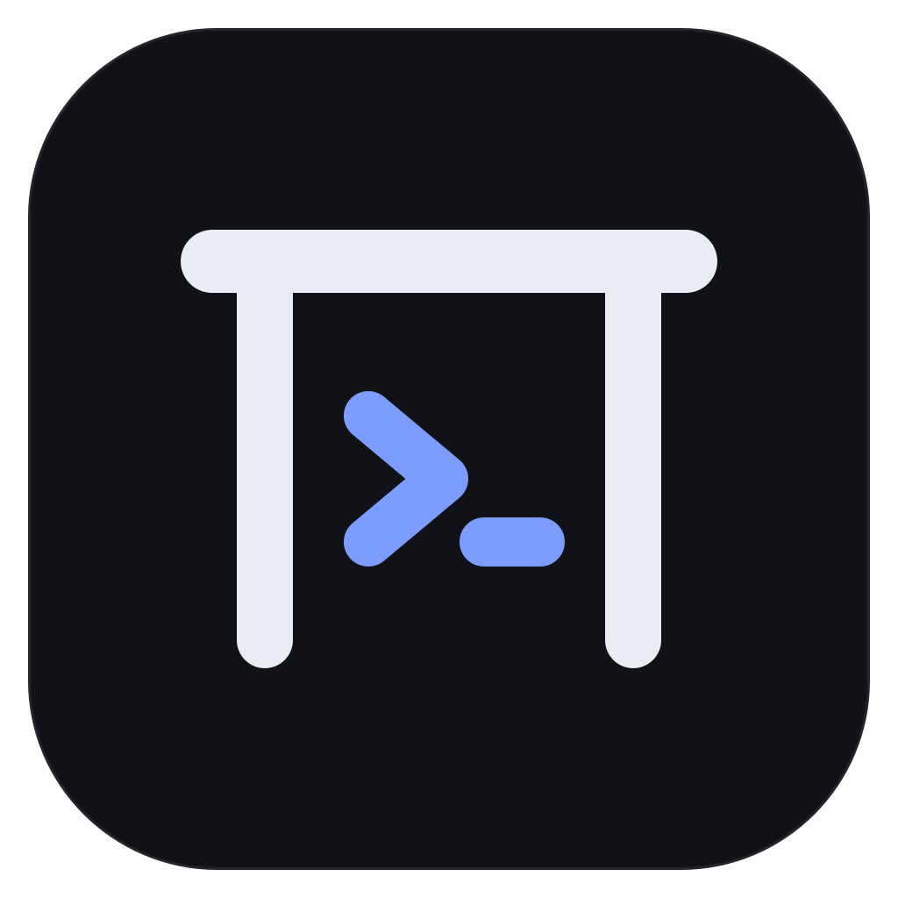
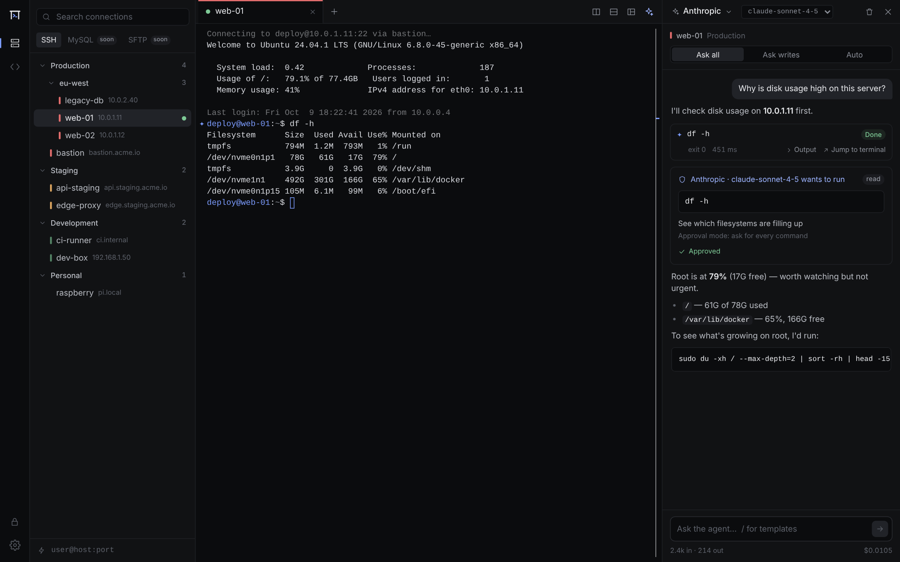
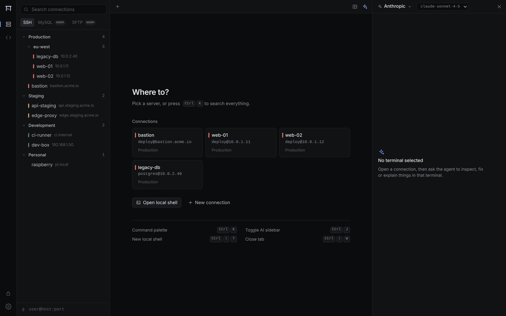
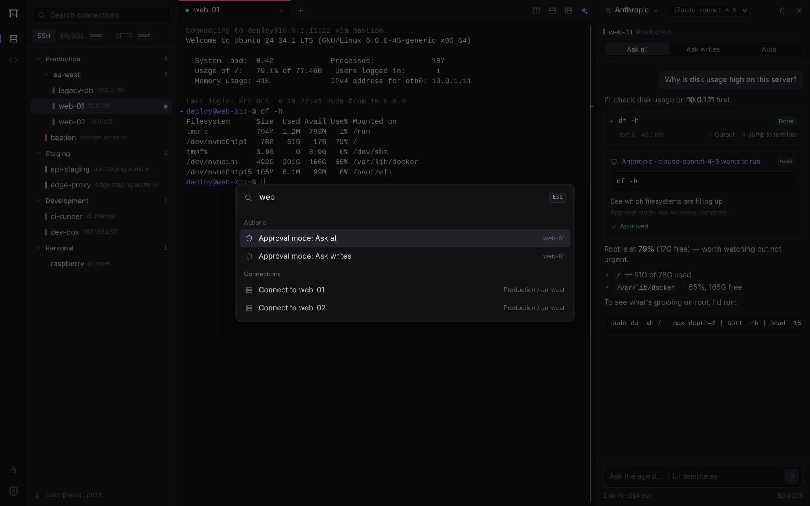
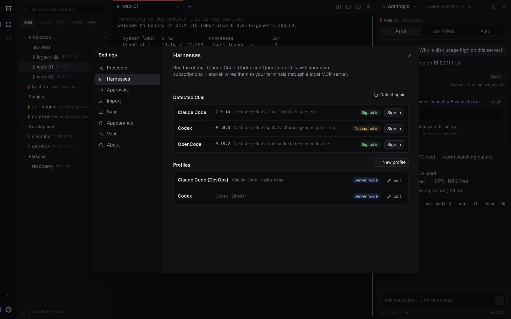
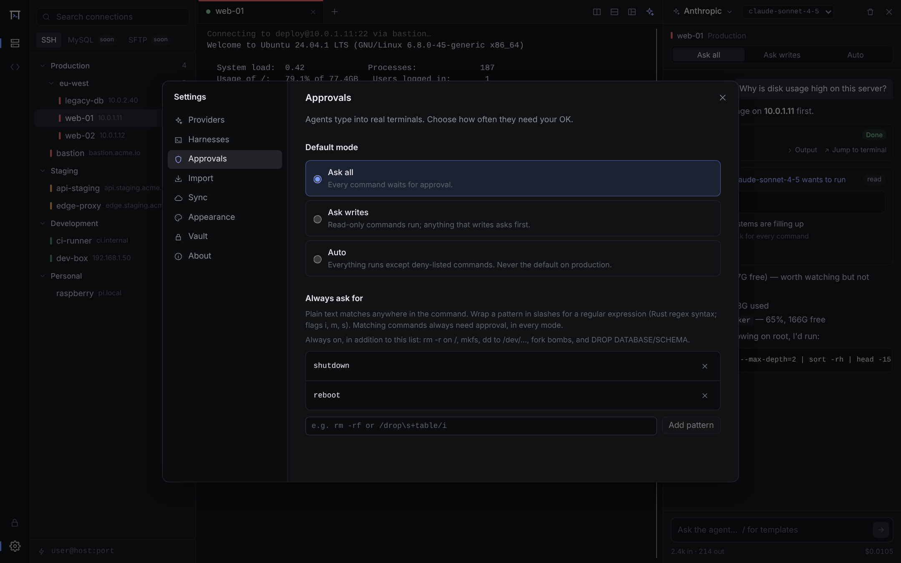
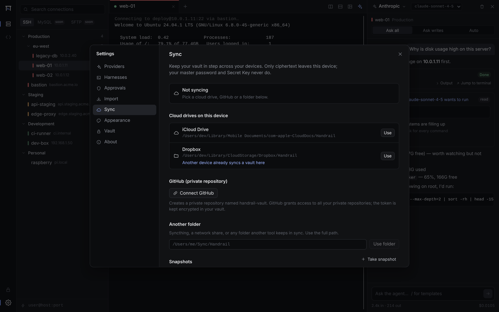
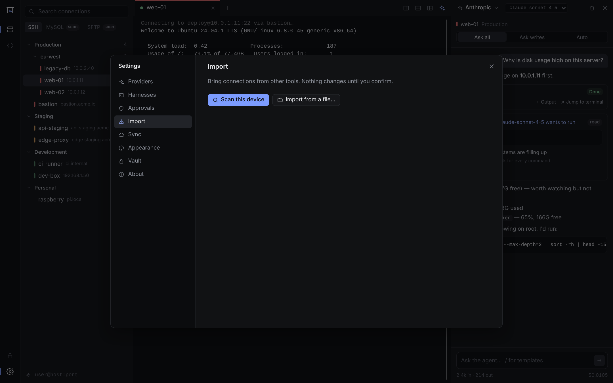
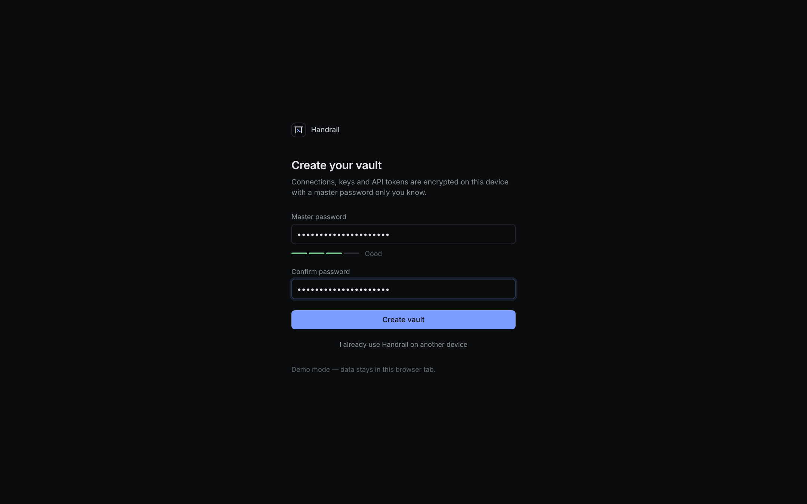
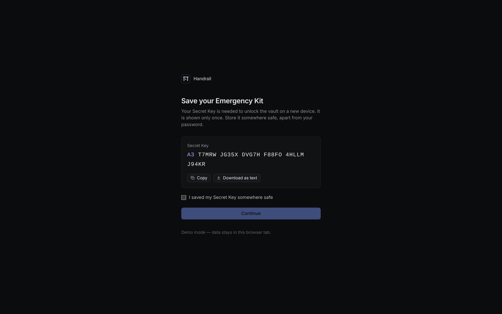

<p align="center">
  
</p>

<h1 align="center">Handrail</h1>

<p align="center">
  An SSH manager where AI agents work <strong>in your live terminal</strong>, with you holding the rail.
</p>

<p align="center">
  <a href="https://github.com/andreafunicelli/Handrail/releases/latest">Download for macOS and Windows</a>
</p>



## What it does

- **Connections:** SSH connections live in nested groups. You can search them, give each environment a color and use jump hosts (ProxyJump). MySQL is coming next.
- **The agent types into the terminal you are looking at.** No hidden shell: every command shows up in your tab, and you can take over at any time (Esc).
- **Approvals:**
  - Three modes: *Ask all*, *Ask writes* (reads run, writes wait for you) or *Auto*. You can approve, edit or deny each command.
  - A deny-list that you extend with plain text or `/regex/` patterns, on top of a built-in list of destructive commands (`rm -r /`, `mkfs`, `dd` to a device, fork bombs, `DROP DATABASE`).
  - Production servers never default to Auto.
- **Bring your own brain:**
  - API keys for Anthropic, OpenAI, DeepSeek, OpenCode Go/Zen, OpenRouter, or local models through Ollama and LM Studio.
  - Your own **Claude Code**, **Codex** or **OpenCode** CLI, on your own subscription, with your skills and plugins.
- **End-to-end encrypted vault:**
  - Your master password plus a Secret Key (Argon2id, XChaCha20-Poly1305), with an Emergency Kit to save once.
  - Snapshots you can roll back to.
  - Sync conflicts are kept, so a lost edit can be brought back.
- **Sync across macOS and Windows:**
  - In one click through a cloud drive (iCloud Drive, Dropbox, OneDrive, Google Drive), or through a private GitHub repository.
  - Or through any folder (Syncthing, a network share).
  - Only ciphertext leaves the device. Sync runs automatically after edits and every few minutes.
- **Import** from `~/.ssh/config`, PuTTY, MobaXterm, mRemoteNG, WinSCP, SecureCRT and Tabby.
- **Files over SFTP:** browse, create, upload, download, rename and delete on any SSH session, over the same login (right-click a folder or the empty list for New file / New folder). Switch to **root** (through sudo) for system files.
- **Copy between servers:** send a file or a whole folder from one server to another (or to another folder of the same one) without downloading it first. It streams over both connections, keeps permissions, and asks before replacing anything.
- **Code editor with the agent:** edit files on the server (as root too) in a VS Code–style editor: syntax highlighting for about 40 languages, minimap, indentation guides, multiple cursors, find and replace, go to line, word wrap, zoom, and a status bar for position, indentation, line endings and language. Saves check that the file didn't change on the server and keep a `.bak` of the original. Ask the agent about the file or a selection; its changes arrive as a diff you accept or reject.
- **S3 buckets:** Amazon S3, Cloudflare R2, Backblaze B2, Wasabi, MinIO or any S3-compatible store, in the same file browser. Keys stay in the vault.
- **Snippets:** saved commands with `{{placeholders}}`, plus suggested read-only diagnostics (disk, memory, ports, logs, TLS expiry) to run or keep.
- **Port forwarding:** local (`-L`), remote (`-R`) and SOCKS5 (`-D`) tunnels saved on a connection. They start with each session, come back after a reconnect, and show their state under the terminal (click one to copy its address).
- **Server bar:** CPU, memory, disk, load and uptime of the server under each SSH terminal, read over the existing connection without typing anything into your shell (Linux servers; can be turned off).
- **Type in all panes:** split a tab across several servers and type (or run a snippet) in all of them at once. Every pane that receives the input is outlined until you turn it off.
- **Keys & passwords:** pick a saved key or password for many connections, and replace it once for all of them (e.g. when you rotate a key). Unused ones can be cleaned up.
- **Keyboard-first:** a command palette (Ctrl/⌘ K), split panes and tabs, saved workspaces.
- **Updates itself:** it checks for new releases and installs one when you click "Update and restart".

## A tour

| | |
|---|---|
|  |  |
| **Connections** in groups and environments. | **Command palette:** connect, switch approval mode, anything. |
|  |  |
| **Harnesses:** Claude Code, Codex and OpenCode, detected and wired in. | **Approvals:** default mode and deny-list. |
|  |  |
| **Sync** through a cloud drive, GitHub or a folder. | **Import** from other SSH managers. |
|  |  |
| **Vault:** master password plus Secret Key. | **Emergency Kit:** the one thing to keep safe. |

## Install

Download the latest `.dmg` (macOS, Apple silicon and Intel) or `.exe` (Windows) from the [releases page](https://github.com/andreafunicelli/Handrail/releases/latest).

The builds are not code-signed yet:
- **macOS:** the first time, open **System Settings › Privacy & Security** and click **Open Anyway**. Or run `xattr -dr com.apple.quarantine /Applications/Handrail.app`.
- **Windows:** on the SmartScreen warning, click **More info › Run anyway**.

On a second device, choose **"I already use Handrail on another device"**. Then pick the same cloud drive or GitHub account and enter the Secret Key from your Emergency Kit.

## How agents reach the terminal

```
Svelte UI ── Tauri IPC ── Rust core
                           ├─ aht-term   single control path: shell integration (OSC 133),
                           │             run_command, approval policy, output store
                           ├─ aht-agent  built-in agent ──┐
                           └─ aht-mcp    local MCP server ┴─ same TerminalTools
                                         ▲ 127.0.0.1, per-launch bearer token
                              Claude Code / Codex / OpenCode (aht-harness)
```

The built-in agent and the external harnesses call the same tools: `list_connections`, `open_session`, `list_sessions`, `session_info`, `run_command`, `read_output` and `send_keys`. `aht-term` enforces approvals, so neither kind of agent can skip them. In *server mode* a harness's own shell and edit tools are disabled, so it can act only through these approved tools.

**Subscriptions:** Claude Code and Codex always run as their official, unmodified CLIs. You sign in to them yourself, and Handrail never reads their credential files. Claude Code opens in its own interface, in a pane next to your SSH tab. Showing it in the AI sidebar instead is an opt-in setting.

## Development

Prerequisites:
- Rust stable
- Node 22
- On Windows: WebView2
- On Linux: `libwebkit2gtk-4.1-dev` and related packages

```bash
npm install
npx tauri dev                    # the desktop app
npm run dev                      # the UI alone, in a browser, against an in-memory mock backend
cargo test --workspace
npm run check && npm run test
```

Two environment variables help when testing:
- `HANDRAIL_DATA_DIR=<dir>` runs against a throwaway vault.
- `HANDRAIL_FILE_KEYSTORE=1` stores the Secret Key in a file instead of the OS keychain.

| Crate | Purpose |
|---|---|
| `aht-core` | Shared types, the `TerminalTools` trait, tool specs |
| `aht-vault` | Encrypted item store, Secret Key, snapshots, sync merge |
| `aht-ssh` | russh client, known hosts, ProxyJump, agent auth, local PTYs |
| `aht-term` | VT/OSC 133 tracking, hidden shell integration, `run_command`, policy |
| `aht-mcp` | Streamable-HTTP MCP server with bearer auth and Host/Origin checks |
| `aht-harness` | Detects, configures and launches Claude Code, Codex and OpenCode |
| `aht-providers` | Anthropic, OpenAI and OpenAI-compatible streaming adapters |
| `aht-agent` | Built-in tool-loop agent |
| `aht-sync` | GitHub (device flow, Git Data API), cloud-drive and folder sync |
| `aht-import` | Importers for other SSH managers |

Design spec: [`docs/superpowers/specs/2026-10-10-aihubterm-design.md`](docs/superpowers/specs/2026-10-10-aihubterm-design.md). It was written while the project was called AIHubTerm.

### Installers and updates

The **Release** workflow (`.github/workflows/release.yml`) builds a universal macOS `.dmg` and Windows `.exe`/`.msi` installers:
- On every push to `main`, it publishes them as a GitHub Release named `v<major>.<minor>.<build number>`.
- On pull requests, it attaches them as workflow artifacts.

The version lives only in the workspace `Cargo.toml`, and CI stamps the build number into it.

Updates need two things:
1. **An updater key pair** from `npx tauri signer generate`.
   - The public key goes in `plugins.updater.pubkey` in `src-tauri/tauri.conf.json`.
   - The private key and its password go in the repository secrets `TAURI_SIGNING_PRIVATE_KEY` and `TAURI_SIGNING_PRIVATE_KEY_PASSWORD`.
2. **Releases in this repository.** Every push to `main` publishes one here, with a changelog of the pull requests merged since the previous release. The updater reads `latest.json` from the latest release.

Releases used to go to the separate `andreafunicelli/handrail-releases` repository, and apps installed from there still look for updates there. While the secret `RELEASES_TOKEN` (a token with "Contents: read and write" on that repository) exists, each release also copies its `latest.json` there, so those apps update to a version that looks here. Delete the secret once they have updated.

### Renamed from AIHubTerm

Existing installs carry over:
- the data directory (`dev.aihubterm.app`) is moved on first launch;
- the Secret Key saved in the keychain is still found;
- an existing `aihubterm-vault` GitHub repository is reused;
- an `AIHubTerm` cloud-drive folder that holds a vault is reused.

## Status

Pre-release (v0.1). Before a public release:
- choose a license;
- set up code signing and notarization;
- confirm with Anthropic and OpenAI that the subscription integration complies with their terms.
