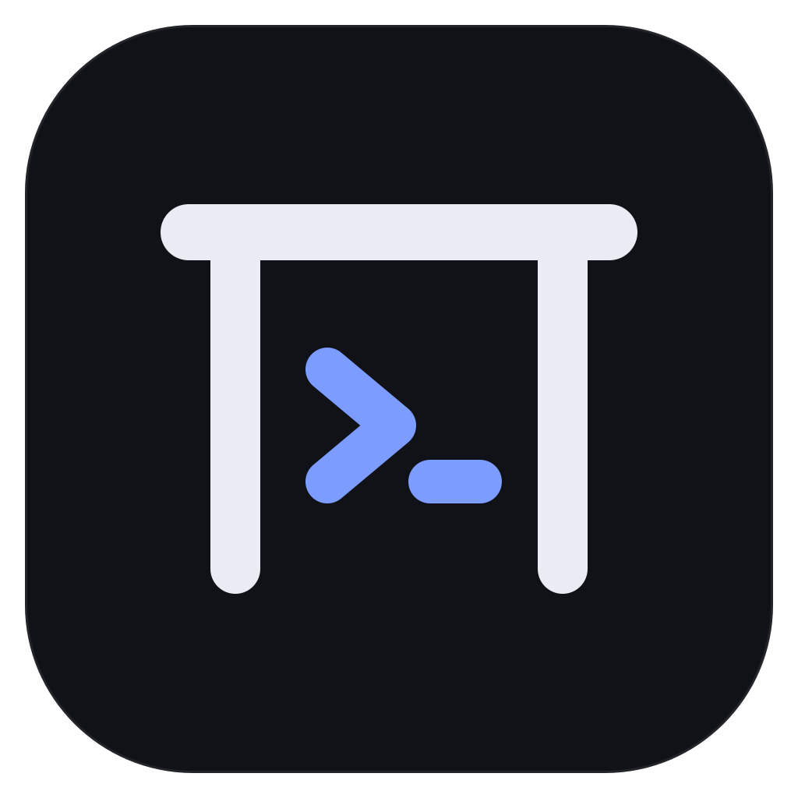
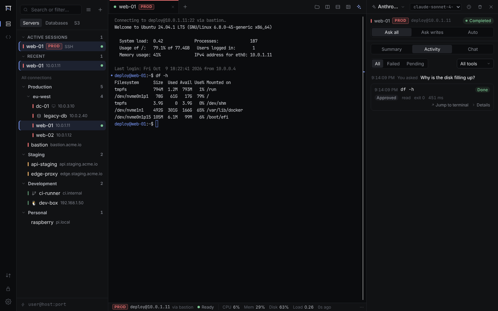
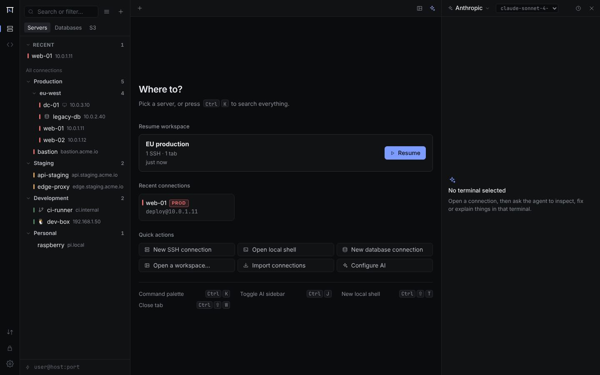
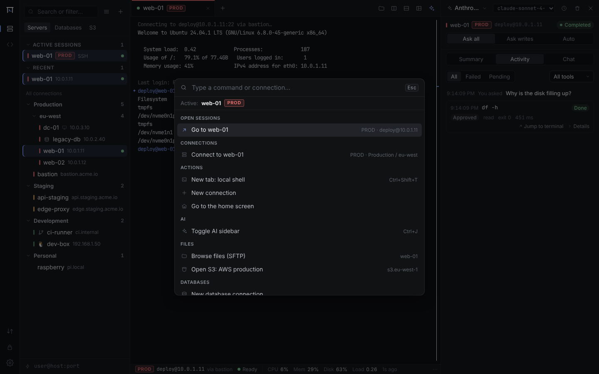
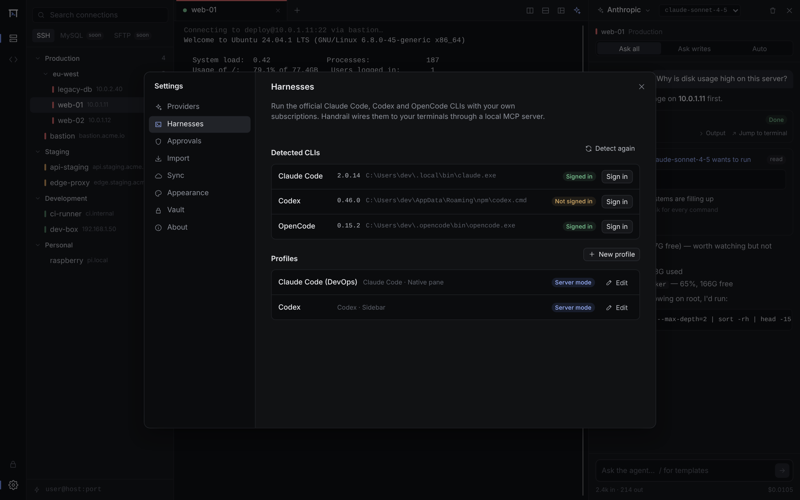
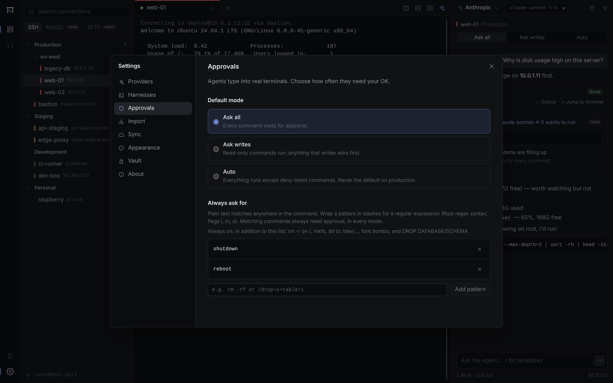
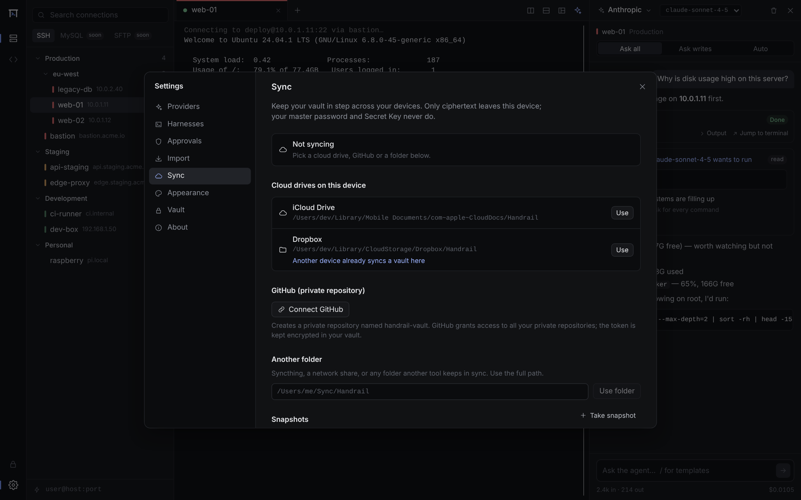
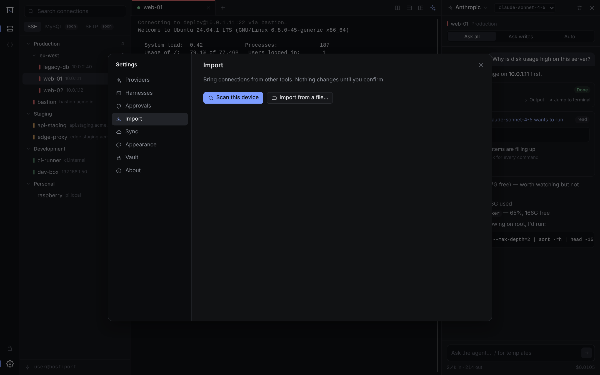
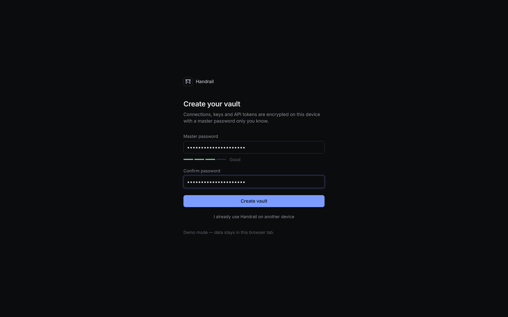
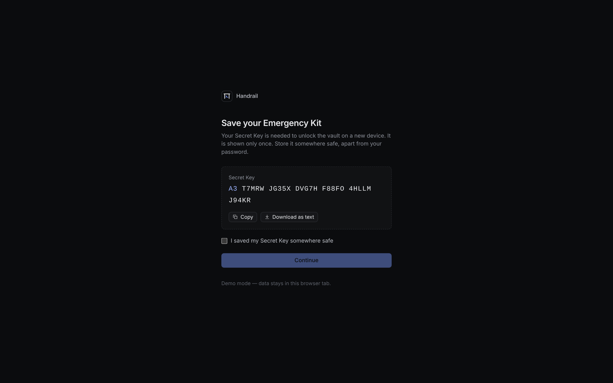

<p align="center">
  
</p>

<h1 align="center">Handrail Terminal</h1>

<p align="center">
  <strong>AI in your terminal. You in command.</strong>
</p>

<p align="center">
  An SSH workspace for macOS, Windows and Linux that brings your servers, files, and AI agents together.<br />
  Watch agents work in your live terminal, review commands, and take over whenever you need to.
</p>

<p align="center">
  <a href="https://github.com/andreafunicelli/Handrail/releases/latest"><strong>Download</strong></a>
  · <a href="#quick-start">Quick start</a>
  · <a href="#features">Features</a>
  · <a href="#development">Development</a>
  · <a href="https://github.com/andreafunicelli/Handrail/issues">Report an issue</a>
</p>



## What's new in 1.1

Handrail 1.1.0, the *Workspace Experience Update*, reworks the interface around the work in front of you. Full list in the [changelog](CHANGELOG.md); compatibility and known limitations in the [release notes](docs/release-notes-1.1.0.md).

- **Home** resumes your last workspace and lists favorites, recent connections and quick actions.
- **Sidebar filters** (`env:prod`, `type:ssh`, `tag:web`, `is:active`, `-env:dev`) and an **Active sessions** section.
- **Production is labelled**, not only coloured, in tabs, panes, the sidebar, the AI panel and approval cards.
- **The AI sidebar** has Summary, Activity and Chat views. An encrypted **operations history** records agent operations, with the command text redacted and no terminal output.
- **Dual-pane file manager**, a **transfer panel**, and a **comparison before anything is overwritten**.
- **Test connection** from the editor, without saving, and an editor in sections.
- **Interface density** (Comfortable or Compact) and an **Italian** translation.
- **SQL backups** can be browsed without a server, and databases can be exported and imported.

## Your servers. Your tools. Your call.

Handrail Terminal is for people who manage servers and want AI help with the work in front of them. Organize SSH connections, open remote desktops, move files, and ask an agent to investigate an issue in the same workspace.

The agent uses the terminal you are looking at. Its commands and their output appear in your session, with approvals enforced by the terminal layer. Use the built-in agent with your chosen model provider, or connect Claude Code, Codex, or OpenCode.

## Quick start

1. **Install the app.** Download the latest installer from [GitHub Releases](https://github.com/andreafunicelli/Handrail/releases/latest).

   | Platform | Download |
   | --- | --- |
   | macOS, Apple silicon or Intel | Universal `.dmg` |
   | Windows, x64 | `.exe` installer or `.msi` |
   | Linux, x64 (glibc 2.35 or newer: Ubuntu 22.04, Debian 12, Fedora 36 and later) | `.AppImage`, `.deb` (Debian, Ubuntu) or `.rpm` (Fedora, openSUSE) |

   Current installers and the installed app use the name **Handrail**. Builds are not code-signed yet: on macOS, use **System Settings › Privacy & Security › Open Anyway** after attempting to open the app; on Windows, use **More info › Run anyway** if SmartScreen appears. On Linux, make the AppImage executable (`chmod +x`) before running it. Without a keychain service (GNOME Keyring, KWallet), the app asks for the Secret Key at each unlock.

2. **Create your vault.** Choose a master password and save the Emergency Kit containing your Secret Key.
3. **Add a connection.** Enter an SSH host or import existing connections from another client.
4. **Connect and work.** Use the terminal and file browser directly. For AI assistance, add a model provider or configure an installed CLI in Settings, then choose an approval mode.

A guided tour runs after vault creation. Replay it from **Settings › About** or **Take the tour** in the command palette. The app also checks for new releases; install an available update with **Update and restart**.

**Trying unreleased builds?** Every push to the `nightly` branch publishes a *Handrail Nightly* prerelease (`nightly-<version>`, e.g. `nightly-1.1.0-212`) on the [releases page](https://github.com/andreafunicelli/Handrail/releases). It installs beside the stable app with its own data folder, and updates itself from the nightly channel. On Linux, use the nightly AppImage to keep both: the nightly and stable `.deb`/`.rpm` packages conflict. A nightly that opens your synced vault edits the same data your other devices use, so use a test vault or a separate sync folder for testing. Stable installs never receive nightly builds.

**Setting up another device?** Choose **“I already use Handrail on another device”**, select the same sync destination, and enter the Secret Key from your Emergency Kit and your master password.

## AI assistance with visible commands

Ask the agent to check disk usage, inspect logs, or explain a configuration file. You see the commands it runs and can approve, edit, or deny commands that require review. Press **Esc** to take over.

| Approval mode | What runs automatically | What waits for approval |
| --- | --- | --- |
| **Ask all** | No agent commands | Every command |
| **Ask writes** | Commands classified as reads | Commands classified as writes or destructive |
| **Auto** | Commands classified as reads or writes | Commands classified as destructive |

Commands matching the deny-list always require approval, including in Auto mode. Extend the built-in patterns with plain text or `/regex/` rules. For production connections, the terminal policy treats Auto as Ask writes.

Classification is based on command syntax and known patterns; it does not prove that a command is harmless.

### Choose your agent

| Option | Connect it with |
| --- | --- |
| **Built-in agent, hosted models** | Your API key for Anthropic, OpenAI, DeepSeek, OpenCode Go/Zen, OpenRouter, or a custom OpenAI-compatible endpoint |
| **Built-in agent, local models** | Ollama or LM Studio |
| **External CLI agents** | Your installed Claude Code, Codex, or OpenCode CLI, with its own login, skills, and plugins |
| **OpenChamber** | OpenCode’s web interface in a separate window, selected in an OpenCode profile |

Claude Code and Codex run as their official, unmodified CLIs. You sign in through those tools; Handrail does not read their credential files. Claude Code opens in its own interface beside your SSH tab by default; using the AI sidebar is opt-in.

## Features

### Connections and terminals

- **Organize your servers:** nested groups, environment colors and labels, and SSH jump hosts through ProxyJump. Search combines fuzzy text with filters: `env:`, `type:`, `tag:`, `host:`, `user:`, `group:`, `is:active`, `is:fav`; prefix `-` to exclude, separate values with commas (`env:prod,staging`). Favorites, recent connections and open sessions have their own sidebar sections.
- **Build your workspace:** tabs, split panes, saved workspaces resumed from the home screen, and a command palette with **Ctrl/⌘ K** grouped into sessions, connections, workspaces, AI, files, databases and settings.
- **Know where you are:** the bar under SSH terminals shows the user, host, jump host and session status, with quick actions (SFTP, new terminal, split, copy host, database through this host). Before a connection is saved, **Test connection** checks the login without opening a shell; unknown host keys are reported, never accepted.
- **Reuse credentials:** share saved keys and passwords across connections, then rotate them in one place. Identities bundle a user name with its password, key or agent: connections that log in as an identity pick up any change to it.
- **Save repetitive work:** command snippets with `{{placeholders}}` and suggested read-only diagnostics.
- **Manage tunnels:** saved local (`-L`), remote (`-R`), and SOCKS5 (`-D`) forwarding, restored after reconnect.
- **Watch server health:** CPU, memory, disk, load, and uptime beneath Linux SSH terminals, collected over the existing connection. Readings show when they were taken, and old values are marked stale instead of being shown as live.
- **Work across servers:** broadcast typing or snippets to selected split panes, with receiving panes visibly outlined.

Import connections from `~/.ssh/config`, PuTTY, MobaXterm, mRemoteNG, WinSCP, SecureCRT, and Tabby.

### Files and editing

- **SFTP browser:** browse, create, upload, download, rename, and delete files using the existing SSH login. Switch to root through sudo for system files.
- **Remote code editor:** syntax highlighting, multiple cursors, find and replace, minimap, and indentation guides. Saves check for remote changes and keep a `.bak` of the original.
- **Agent-assisted edits:** ask about a file or selection, then accept or reject the proposed diff.
- **S3-compatible storage:** work with Amazon S3, Cloudflare R2, Backblaze B2, Wasabi, MinIO, and compatible services from the file browser.
- **Search and select files:** in SFTP and S3 browsers, filter a folder or search its subfolders by name or pattern (`*.log`), and select many files (Ctrl/Cmd-click, Shift-click, Ctrl+A) to download, copy or delete them together.
- **Dual pane:** open a second pane on this computer, another connected server, or an S3 account. **F5** copies between the panes (files both ways between this computer and a server or S3; folders between servers), **F6** moves within one file system, **Tab** switches pane.
- **Compare before overwrite:** a copy or upload onto an existing file shows both files' size, time and permissions, and a line diff for text files up to 256 KB.
- **Transfer panel:** uploads, downloads and copies with their progress and errors, from the icon rail.
- **Copy between destinations:** stream files and folders between servers, or files between a server and S3, without first saving a local copy. Server-to-server transfers preserve permissions; replacements require confirmation.

### Remote desktops

Open Windows desktops over RDP in tabs beside your terminals. Use NLA authentication with vault credentials, keyboard and mouse input, a shared clipboard for copying text both ways (on macOS, ⌘ works as Ctrl), a desktop that resizes with the pane, and an administrative session when needed. Reach hosts behind a bastion through an SSH tunnel using the connection’s jump hosts.

RDP runs in a separate `handrail-rdp` helper process built on [IronRDP](https://github.com/Devolutions/IronRDP).

### Databases

Open MySQL/MariaDB and PostgreSQL databases in tabs: browse schemas and tables, write SQL with completion, and page through results in a fast grid with CSV export. Browse a table page by page, sorted by any column and filtered with a `WHERE` condition; see each table's estimated rows, size and engine, a database overview, and the `CREATE` statement of any table or view. The Structure tab shows columns, indexes and foreign keys and lets you change them, or create a table, after reviewing the exact `ALTER`/`CREATE` SQL; rename, empty or drop tables and create or drop databases the same way, with the name typed to confirm anything destructive. The Server panel lists the server's processes (stop a query or close a connection), variables, status counters and accounts; create accounts, change their password, grant or revoke privileges and drop them (the SQL is built by Handrail and shown with the password masked). Keep several query tabs per database, rerun anything from the query history, run just the statement under the cursor (Ctrl/⌘+Shift+Enter), and save results as CSV, JSON or SQL `INSERT` statements. Export a database or schema to SQL, import SQL files (including `pg_dump`'s `COPY` blocks) or CSV into a table, and open a `.sql` or `.sql.gz` backup without a server to browse its tables and save one as CSV, JSON or SQL. **Focus SQL** hides the schema panel and gives the editor most of the tab; the splitter between editor and results is dragged or moved with the arrow keys and remembered on each device. Tables with a primary key can be edited in the grid; changes are saved together in one transaction. Reach a database through an SSH tunnel: pick the SSH server(s) to go through and set the host as seen from the last one, usually `localhost` (an SSH server’s menu has *New database on this server* to set this up). TLS is optional.

Share a database tab with agents to let them read its schema and query it. Reads run in a read-only transaction; writes wait for your approval according to your settings (always on production connections), and destructive statements such as `DROP` or a `DELETE` without `WHERE` always do. The request appears in the database tab with the full SQL.

### Agent activity and history

The AI sidebar's **Activity** view lists each step the agent took (command, target, risk, approval, exit code, duration, output), built only from events the terminal reports. **Summary** collects the request, the commands, the errors and the changes without calling the model. Pending approvals stay visible in every view. **Settings › Approvals** keeps an operations history in the vault, encrypted and per device. Known secret patterns in the command are masked, terminal output is never stored, and retention can be configured or the history cleared. External CLIs running in their own window are not covered.

### Appearance and language

Choose **Comfortable** (the default) or **Compact** density and English or Italian in **Settings › Appearance**. The terminal and editor keep their own font sizes.

## Encrypted vault and sync

Connections, saved credentials, and provider keys live in a vault protected by your **master password and Secret Key**, using Argon2id and XChaCha20-Poly1305.

- **Choose your sync destination:** a cloud-drive folder such as iCloud Drive, Dropbox, OneDrive, or Google Drive; a private GitHub repository; or another folder, including Syncthing and network shares.
- **Sync encrypted data:** only ciphertext is sent to the vault’s sync destination. Sync runs after edits and periodically.
- **Recover earlier work:** restore snapshots or recover edits retained during sync conflicts.
- **Start over if needed:** delete the local vault from the unlock screen or **Settings › Vault**. Synced copies are retained.

Keep the Emergency Kit somewhere safe. Vault encryption protects stored and synced data; when you use AI, the selected provider or CLI receives the conversation and tool results needed for that session.

<details>
<summary><strong>More screenshots</strong></summary>

| Connections | Command palette |
| --- | --- |
|  |  |

| Agent integrations | Command approvals |
| --- | --- |
|  |  |

| Vault sync | Connection import |
| --- | --- |
|  |  |

| Vault setup | Emergency Kit |
| --- | --- |
|  |  |

</details>

## Development

The app uses **Svelte 5**, **Tauri 2**, and **Rust**. Install Node.js 22, Rust through rustup (`rust-toolchain.toml` pins the version), and the [Tauri system prerequisites](https://v2.tauri.app/start/prerequisites/) for your platform, including WebView2 and the C++ build tools on Windows.

```bash
git clone https://github.com/andreafunicelli/Handrail.git
cd Handrail
npm ci
node scripts/build-rdp-helper.mjs
npm run tauri -- dev
```

Build the RDP helper before starting the desktop app; Tauri expects it in `src-tauri/binaries/`.

For UI development without the desktop backend:

```bash
npm run dev
```

This runs the UI in a browser against an in-memory mock backend.

### Checks

After installing dependencies and building the helper:

```bash
npm run check
npm run test
npm run build
cargo fmt --all -- --check
cargo clippy --workspace --all-targets --locked -- -D warnings
cargo test --workspace --locked
cargo fmt --manifest-path rdp-helper/Cargo.toml -- --check
cargo clippy --manifest-path rdp-helper/Cargo.toml --all-targets --locked -- -D warnings
cargo test --manifest-path rdp-helper/Cargo.toml --locked
```

The frontend build creates `ui/dist`, which the Tauri build script needs for workspace tests. The RDP helper has its own Cargo workspace and test suite.

For isolated development, set `HANDRAIL_DATA_DIR=<dir>` to use a throwaway vault. `HANDRAIL_FILE_KEYSTORE=1` uses a file for the Secret Key instead of the OS keychain; use it only with test data.

<details>
<summary><strong>Architecture and agent integration</strong></summary>

```text
Svelte UI ── Tauri IPC ── Rust core
                           ├─ aht-term   terminal control and approval policy
                           ├─ aht-agent  built-in agent ──┐
                           └─ aht-mcp    local MCP server ┴─ TerminalTools
                                         ▲
                              Claude Code / Codex / OpenCode
                                      (aht-harness)
```

The built-in agent and external CLIs share `TerminalTools`: `list_connections`, `open_session`, `list_sessions`, `session_info`, `run_command`, `read_output`, and `send_keys`. The terminal layer enforces command approvals. In server mode, the CLI’s own shell and edit tools are disabled so it works through these tools.

The local MCP server listens on `127.0.0.1` with a per-launch bearer token and Host/Origin checks.

| Crate | Responsibility |
| --- | --- |
| `aht-core` | Shared types, `TerminalTools`, and tool specifications |
| `aht-vault` | Encryption, Secret Key, snapshots, and sync merge |
| `aht-ssh` | SSH, known hosts, ProxyJump, agent authentication, and local PTYs |
| `aht-term` | Terminal tracking, shell integration, command execution, and policy |
| `aht-mcp` | Authenticated local MCP server |
| `aht-harness` | Detection, configuration, and launch of external CLI agents |
| `aht-providers` | Anthropic, OpenAI, and OpenAI-compatible streaming adapters |
| `aht-agent` | Built-in agent tool loop |
| `aht-sync` | GitHub, cloud-drive, and folder sync |
| `aht-import` | Connection importers |
| `aht-s3` | S3-compatible storage |
| `aht-db` | MySQL/MariaDB and PostgreSQL client, SQL dumps and backups, statement risk classification |

See the [IPC contract](docs/ipc-contract.md) and the [original design specification](docs/superpowers/specs/2026-10-10-aihubterm-design.md), written under the earlier name AIHubTerm.

</details>

## License and credits

See [LICENSE](LICENSE) for the project’s license terms.

Several interface behaviors are adapted from [Interior](https://github.com/ddoemonn/interior) by ozzy (MIT): hold-to-confirm, busy and copy buttons, the sliding choice marker, and parts of the menu, modal, and command palette. Handrail’s Svelte implementations credit the original work in each file.
